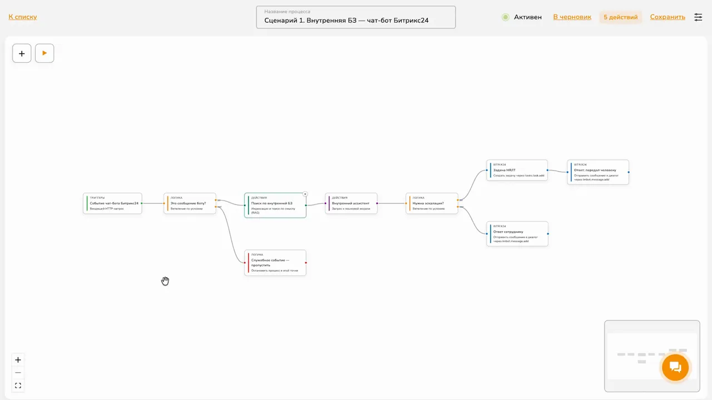
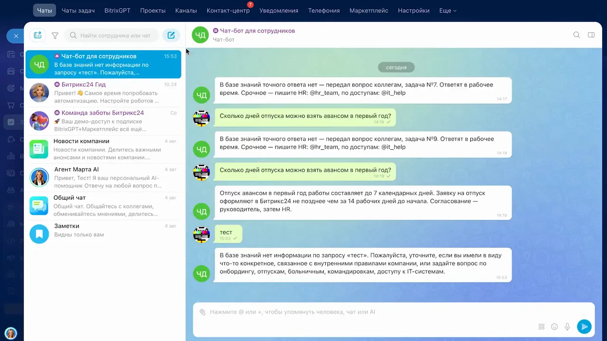
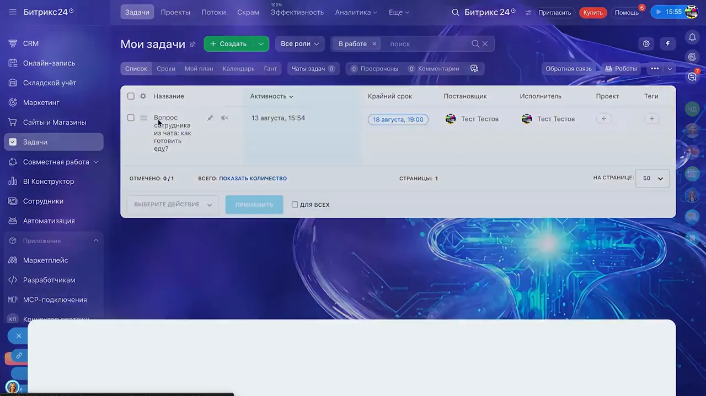
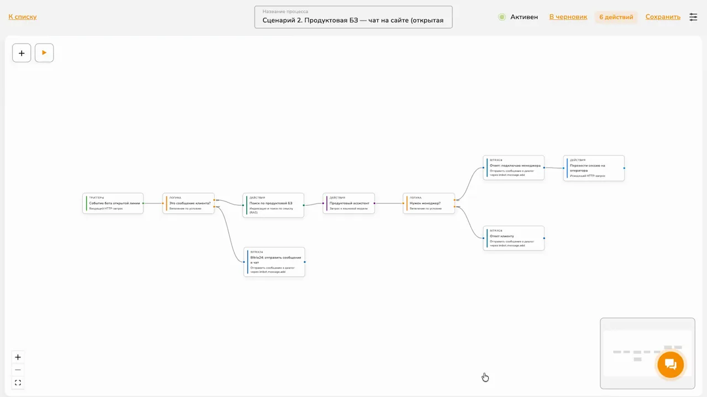
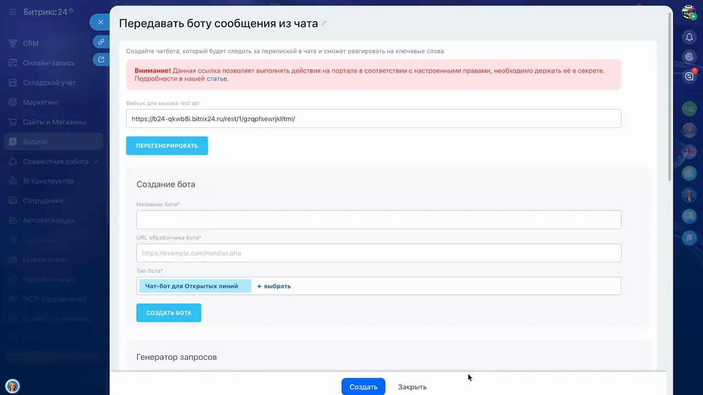
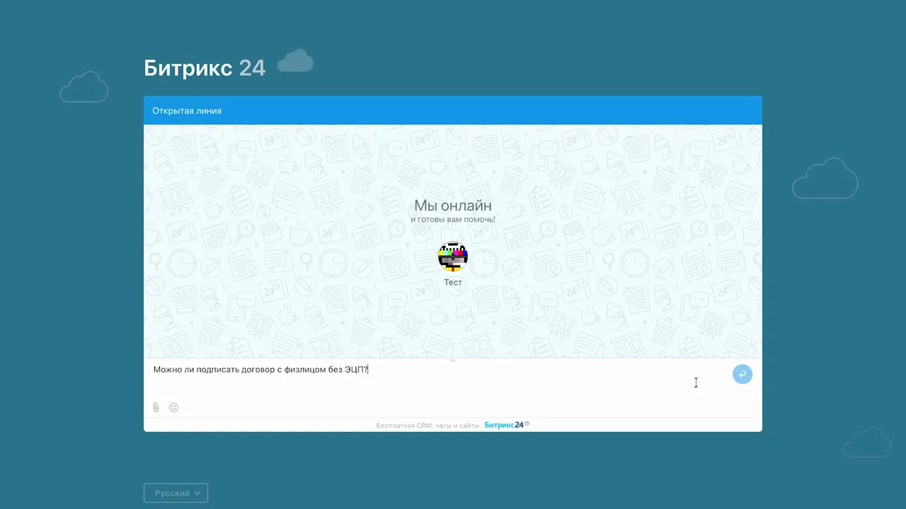

# Чат-бот с базой знаний для Битрикс24 — визуал

## [00:02:33] Схема процесса. Сценарий 1 (внутренняя БЗ)

Линейная схема процесса в редакторе Подпислон. Цепочка нод:

- **Триггеры** — «Событие чат-бота Битрикс24» (входящий HTTP-запрос).
- **Логика** — «Это сообщение боту?» (ветвление по условию). Нижняя ветка → «Служебное событие — пропустить» (остановить процесс).
- **Действия** — «Поиск по внутренней БЗ» (индексация и поиск по смыслу, RAG).
- **Действия** — «Внутренний ассистент» (запрос к языковой модели).
- **Логика** — «Нужна эскалация?» (ветвление). Две ветки Bitrix24:
  - «Задача HR/IT» (`tasks.task.add`) → «Ответ: передал человеку» (`imbot.message.add`);
  - «Ответ сотруднику» (`imbot.message.add`).

## [00:07:25] Демонстрация. Чат с ботом для сотрудников

Чат «Чат-бот для сотрудников» в Битрикс24. Видно поведение по порогу релевантности: на вопрос «Сколько дней отпуска можно взять авансом в первый год?» бот отвечает по БЗ («до 7 календарных дней, заявку оформляют не позднее чем за 14 рабочих дней, согласование — руководитель, затем HR»). На несвязный запрос «тест» — «в базе знаний нет информации по запросу, уточните…».

## [00:08:16] Демонстрация. Созданная задача эскалации

Раздел «Мои задачи» Битрикс24. Бот при невозможности ответить создал задачу «Вопрос сотрудника из чата…» с постановщиком и исполнителем, крайним сроком — подтверждение, что эскалация на сотрудника отработала.

## [00:08:30] Схема процесса. Сценарий 2 (продуктовая БЗ, открытые линии)

Схема процесса в Подпислон:

- **Триггеры** — «Событие бота открытой линии» (входящий HTTP-запрос).
- **Логика** — «Это сообщение клиента?». Нижняя ветка → Bitrix24 «отправить сообщение в чат» (приветствие, `imbot.message.add`).
- **Действия** — «Поиск по продуктовой БЗ» (RAG).
- **Действия** — «Продуктовый ассистент» (запрос к языковой модели).
- **Логика** — «Нужен менеджер?». Две ветки:
  - «Ответ: подключаю менеджера» (`imbot.message.add`) → «Перевести сессию на оператора» (исходящий HTTP-запрос);
  - «Ответ клиенту» (`imbot.message.add`).

## [00:11:24] Конфигурация. HTTP-нода перевода на оператора

Настройки исходящего HTTP-запроса «Перевести сессию на оператора»:

- Метод: `POST`.
- URL: `{{ variables.B24_WEBHOOK_URL }}imopenlines.bot.session…`
- Заголовки (JSON): `Content-Type: application/json`, `Accept: application/json`.
- Тело запроса:
  - `CHAT_ID`: `{{ trigger.json.data.PARAMS.TO_CHAT_ID }}`
  - `TRANSFER_ID`: `queue`
  - `LEAVE`: `Y`
  - `CLIENT_ID`: `{{ trigger.query.CLIENT_ID }}`

## [00:12:36] Демонстрация. Чат клиента на сайте (открытая линия)

Виджет открытой линии Битрикс24 на сайте («Мы онлайн и готовы вам помочь»). Клиент задаёт вопрос «Можно ли подписать договор с физлицом без ЭЦП?» — проверка ответа бота по продуктовой БЗ и последующего перевода на оператора по фразе «Переведи на оператора».
